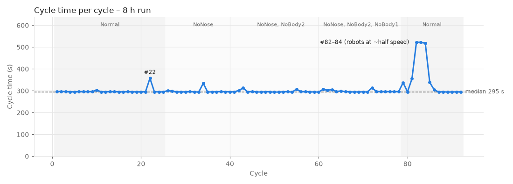
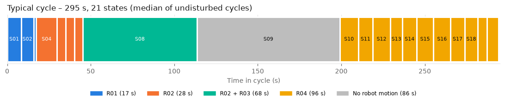
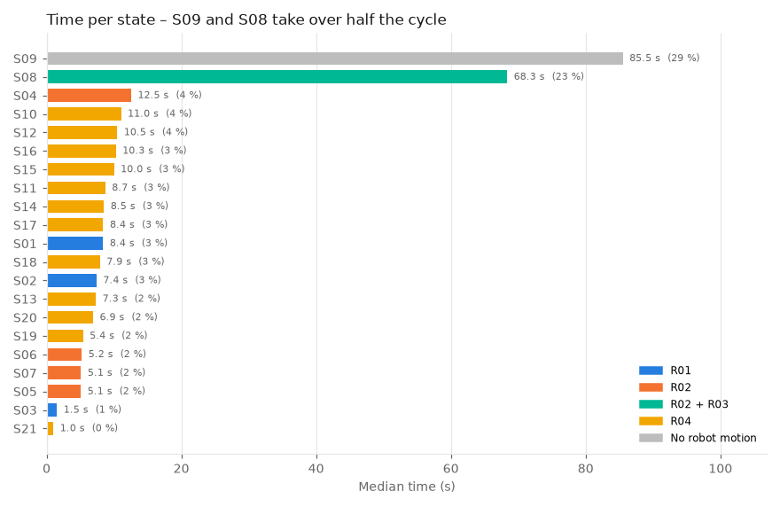
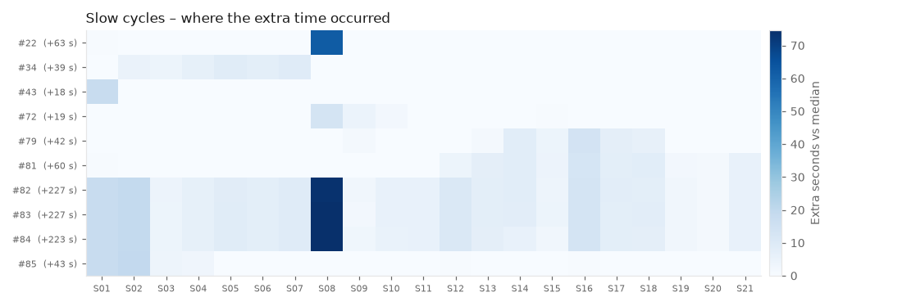
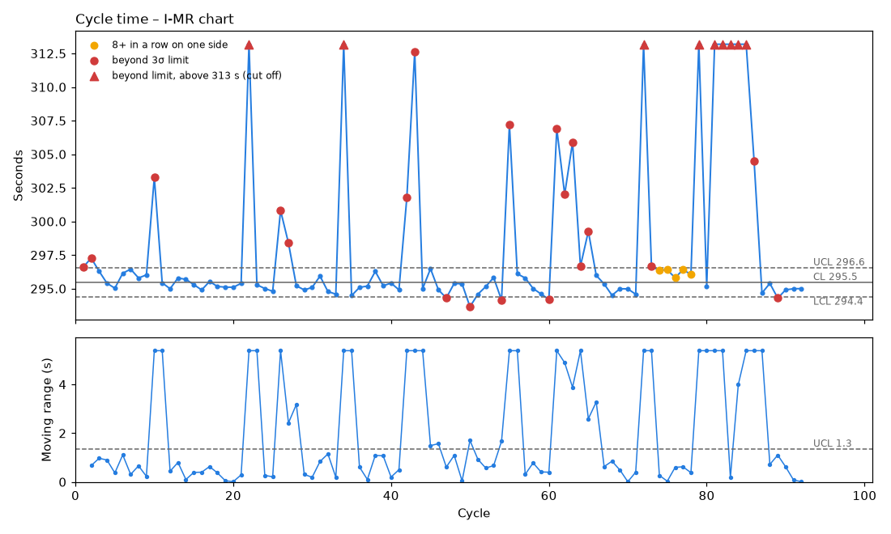
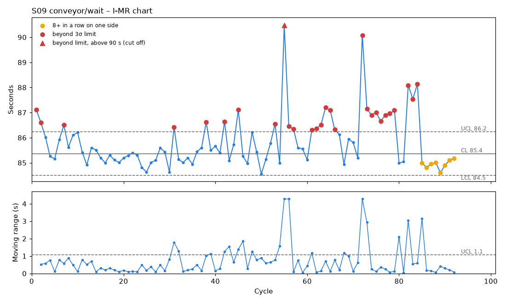

# Robotic Assembly Cell – Data-Driven Cycle-Time Study

Cycle-time analysis of a 4-robot assembly cell using open industrial sensor data (8-hour run, 92 complete cycles).
The goal is to find where cycle time goes, what varies, and where improvement potential lies – the way an
industrial engineer would approach a real production line.

## Key findings (Phase 1)
- **Median cycle time ≈ 295 s**, very stable (72 of 92 cycles within ±1 % of the median).
- **S09 (≈ 85 s, 29 %) has no robot motion** – the tray is on the conveyor / waiting. **S08 assembly (≈ 68 s, 23 %)** is the longest robot state. Together they are over half of every cycle.
- The cell runs **strictly sequentially** – only one robot moves at a time (except during assembly).
- Missing parts in the tray (defect scenarios) do **not** change cycle time.
- **~16 min (≈ 3 cycles of output) lost** in 10 slow cycles; ~70 % of that in cycles 82–84, where all robots ran at about half speed (cause not documented in the dataset).

The 21 cycle states are not documented in the dataset – which robot works in which state was derived from joint-angle motion.






## Key findings (Phase 2 – SPC)
- The undisturbed cell is **extremely repeatable**: short-term sigma of cycle time is only **0.37 s**. Against an assumed 300 s target, **Cpk = 4.15**.
- Yet **18 of 92 cycles (20 %) exceed 300 s** – the losses come from **special causes** (disturbances), not normal variation.
- **S09 (conveyor/wait) drifted** about 1–1.5 s slower from cycle ~55 to 84, then stepped back below its centre line from cycle 85.
- Recommendation: remove disturbances rather than reduce normal variation.

*The dataset has no spec limits – the 300 s target is an assumption.*



## Project structure
```

data/                 raw analog sensor data (7 files)
notebooks/            analysis notebooks
outputs/              charts and the state-time table (Excel)
requirements.txt      Python libraries used
```

## How to run
Requires **Python 3.12**.
```
python -m venv .venv
.venv\Scripts\activate
pip install -r requirements.txt
```
Then open `notebooks/Phase1_Cycle_Time_Study.ipynb` and run all cells.
Update `DATA_DIR` and `OUT_DIR` in the first cell to your folder paths.

## Roadmap
- [x] Phase 1 – Cycle-time study (state-time table, bottlenecks, slow-cycle analysis)
- [x] Phase 2 – SPC: I-MR control charts and process capability
- [ ] Phase 3 – Anomaly detection (sensor fault, missing-part images)
- [ ] Phase 4 – Improvement scenarios with discrete-event simulation

## Data source & licence
Data: *Analog and Multi-modal Manufacturing Datasets Acquired on the Future Factories Platform V2*,
Harik et al., University of South Carolina, 2025 – [arXiv:2502.05020](https://arxiv.org/abs/2502.05020),
[Kaggle](https://www.kaggle.com/datasets/ramyharik/ff-2024-08-13-analog-dataset).
Licensed under [CC BY-SA 4.0](https://creativecommons.org/licenses/by-sa/4.0/); the data in `data/` is redistributed unchanged under the same licence.

## Author
**Karthickk Rahul Srinivasan** – M.Sc. Industrial Engineering, VŠB – Technical University of Ostrava
[LinkedIn](https://www.linkedin.com/in/karthickk-srinivasan)